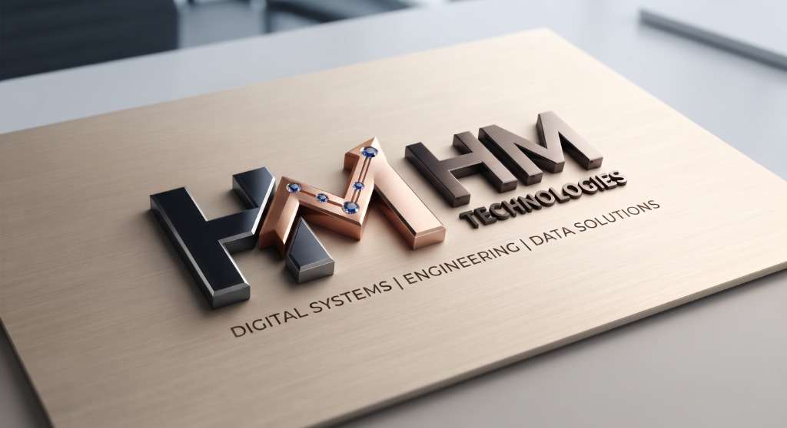

# HM Technologies — Official Web Platform

> **Engineering Digital Systems, Business Workflow Automation & Executive Data Intelligence across Africa & Globally.**



HM Technologies is a premier technology engineering consultancy based in Nairobi, Kenya. We architect high-performance web applications, automate operational workflows with Safaricom Daraja M-Pesa & Zoho ERP, and deploy executive Business Intelligence dashboards for growing and enterprise organizations.

---

## 🚀 Core Capabilities

- **Custom Software & Cloud ERPs:** Full-stack, modular web and desktop systems engineered for scalability and data integrity.
- **FinTech & Workflow Automation:** End-to-end integration with Safaricom Daraja M-Pesa (STK Push, C2B, B2C, reversal webhooks) and Zoho CRM/Creator.
- **Executive Data Analytics:** Automated ETL pipelines and interactive Microsoft Power BI & Python reporting dashboards.
- **Enterprise Web Engineering:** Lightning-fast, mobile-first web platforms built on modern standards.
- **Cloud Infrastructure & SLA Support:** Resilient deployments on Microsoft Azure with 99.9% uptime SLA and rapid response guarantees.

---

## 🛠️ Technology Stack

- **Frontend:** HTML5, CSS3 / Custom Design System, JavaScript (ES6+), Ionicons, Vite
- **Integrations:** Safaricom Daraja M-Pesa APIs, Zoho CRM & Creator APIs, WhatsApp Business API
- **Analytics & Backend:** Microsoft Power BI, Python (FastAPI/ETL), Node.js, PostgreSQL, Redis
- **DevOps & Cloud:** Microsoft Azure, Docker, GitHub CI/CD Actions

---

## 📂 Multi-Page Architecture

- `index.html` — Homepage with dynamic value proposition, executive dashboard mockup, and slow-motion tech marquee.
- `services.html` — Comprehensive breakdown of software, automation, data, and cloud capabilities.
- `projects.html` — Real-world case studies (*Sarah's Nutritive Supplies E-Commerce*, *Nyumbani Plus*, *Sarah's CRM*, *Executive BI Dashboard*, *Highview ERP*).
- `about.html` — Company mission, engineering leadership, and client delivery statistics.
- `reviews.html` — Verified client reviews, ROI metrics, and partner feedback.
- `contact.html` — Secure contact and proposal inquiry portal with 2-hour SLA response.

---

## 💻 Local Development

### Prerequisites
- [Node.js](https://nodejs.org/) (v18 or higher recommended)
- [npm](https://www.npmjs.com/)

### Installation & Startup

```bash
# Clone the repository
git clone https://github.com/Henry-data-debug/hm-technologies.git
cd hm-technologies

# Install dependencies
npm install

# Start local development server with Hot Module Reloading (HMR)
npm run dev
```

Visit `http://localhost:5173` in your browser.

### Production Build

```bash
# Build optimized production bundle for all pages
npm run build

# Preview production build locally
npm run preview
```

The production output is generated in the `dist/` directory.

---

## 🔒 Security & SEO

- **Security:** Hardened against reverse tab-nabbing (`rel="noopener noreferrer"`), input sanitization against XSS, and `nosniff` / `strict-origin-when-cross-origin` policy headers.
- **SEO & Social:** Open Graph, Twitter Cards, Schema.org JSON-LD structured data (`Organization`, `ProfessionalService`), and automated `sitemap.xml` + `robots.txt`.

---

## 📞 Contact & Inquiries

- **Headquarters:** Nairobi Central Business District, Kenya
- **Phone / WhatsApp:** [+254 791 371 301](tel:+254791371301)
- **Email:** [info@hmtechnologies.co.ke](mailto:info@hmtechnologies.co.ke)
- **Website:** [https://hmtechnologies.co.ke](https://hmtechnologies.co.ke)
- **Facebook:** [https://www.facebook.com/hmtechn](https://www.facebook.com/hmtechn)
- **Instagram:** [https://www.instagram.com/hm_technologies.ke](https://www.instagram.com/hm_technologies.ke)

---

&copy; 2026 **HM Technologies**. All Rights Reserved.
